



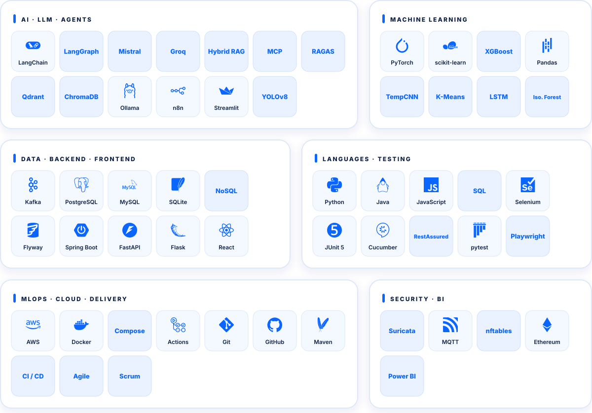

<a href="https://github.com/maryem37/AgriGuide_Project"></a>
<a href="https://github.com/maryem37/RagAndLoopVersionTestProject">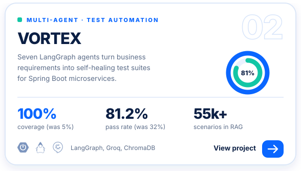</a>
<a href="https://github.com/maryem37/AI-Job-Matcher-Career-Coach-Pipeline">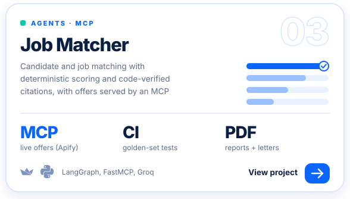</a>
<a href="https://github.com/maryem37/projet_ml_retail">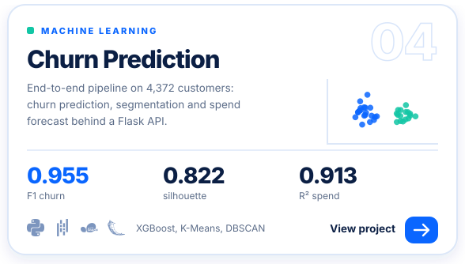</a>
<a href="https://github.com/maryem37/AWS_Vehicle_Tracker">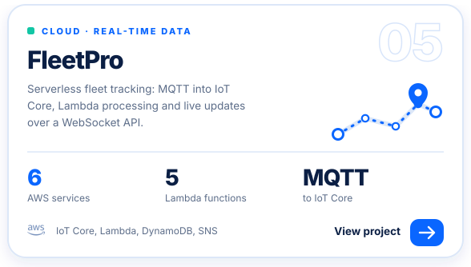</a>
<a href="https://github.com/maryem37/kafkaProject">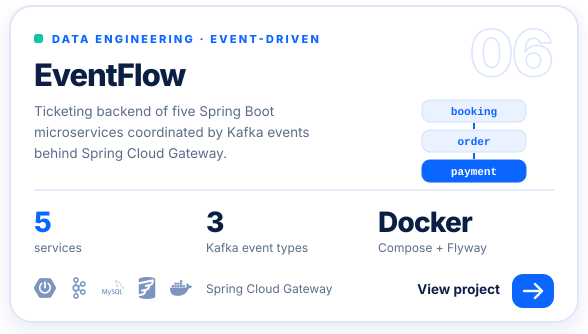</a>
<a href="https://github.com/maryem37/QA-TEST"></a>

<a href="https://github.com/maryem37/PerfPulse-Agent-IA-d-analyse-des-performances-d-entreprise"></a>
<a href="https://github.com/maryem37/EVA-Guard">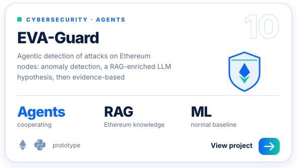</a>
<a href="https://github.com/maryem37/detection_logo_societe"></a>
<a href="https://github.com/maryem37/AnomalieDetection"></a>

<a href="https://github.com/maryem37/ASL_signLanguage">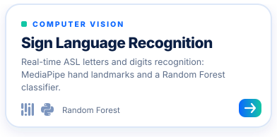</a>
<a href="https://github.com/maryem37/blockchain_medical_app">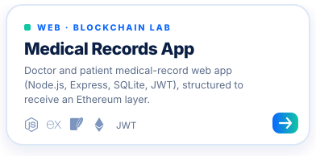</a>

<a href="https://github.com/maryem37/DreamerWorldFamily">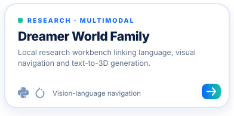</a>
<a href="https://github.com/maryem37/langchain_init">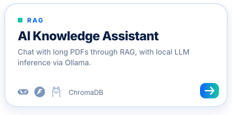</a>
<a href="https://github.com/maryem37/Tutoriel_Kafka_simple">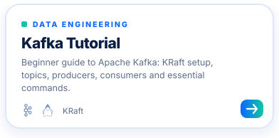</a>
<a href="https://github.com/maryem37/RAGVersionTestProject">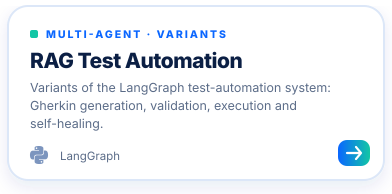</a>
<a href="https://github.com/maryem37/Jaya-Algorithm-Optimization">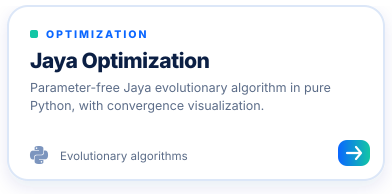</a>
<a href="https://github.com/maryem37/Portfolio">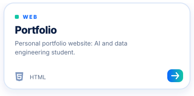</a>

 

**Also:** [QAPilot-AI](https://github.com/maryem37/QAPilot-AI) (API test generation variant) · [signLanguage](https://github.com/maryem37/signLanguage) · [Microservices_Project](https://github.com/maryem37/Microservices_Project) · [ProjectML](https://github.com/maryem37/ProjectML) · [15_AI_Project](https://github.com/maryem37/15_AI_Project) · [all repositories](https://github.com/maryem37?tab=repositories)

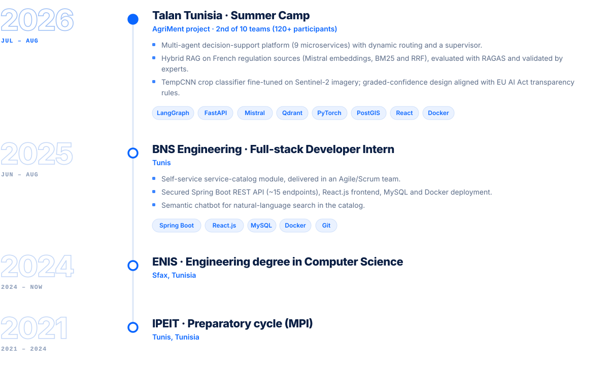

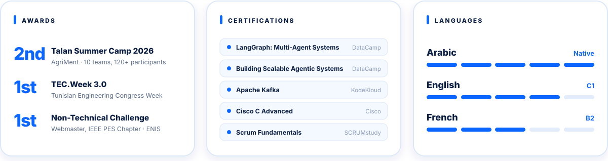

  

